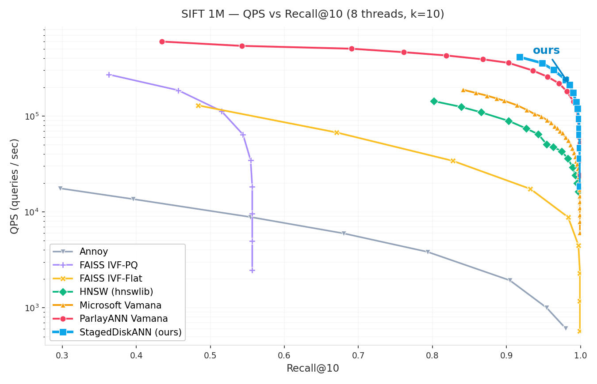
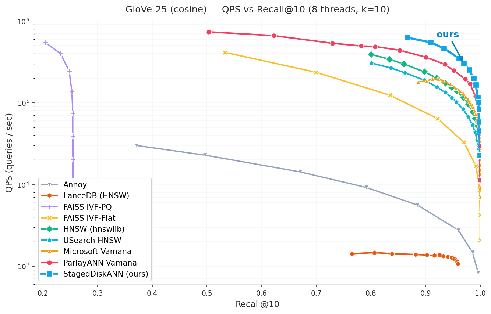
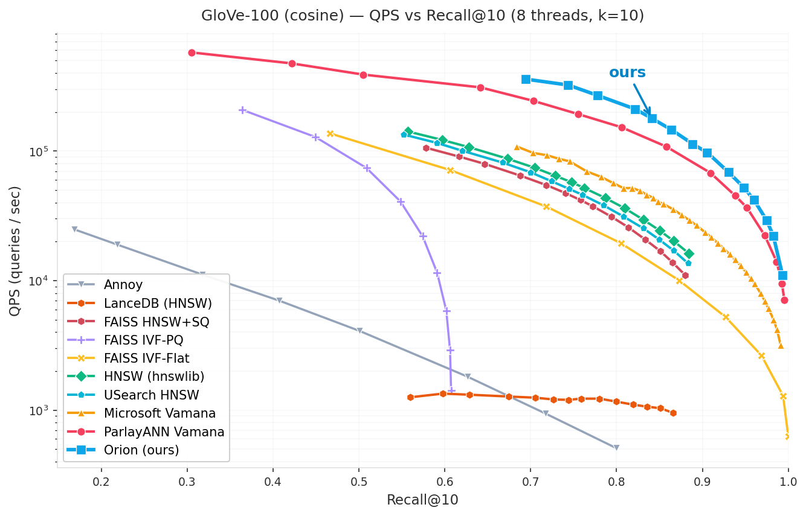
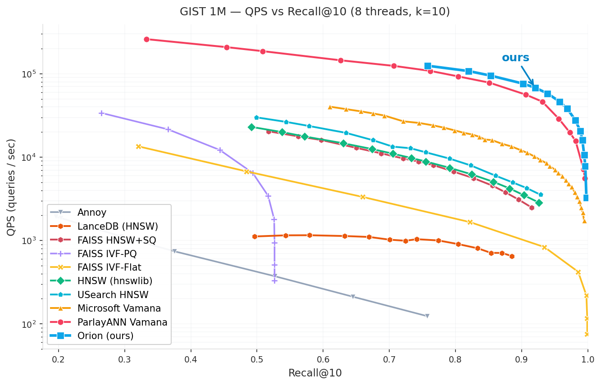
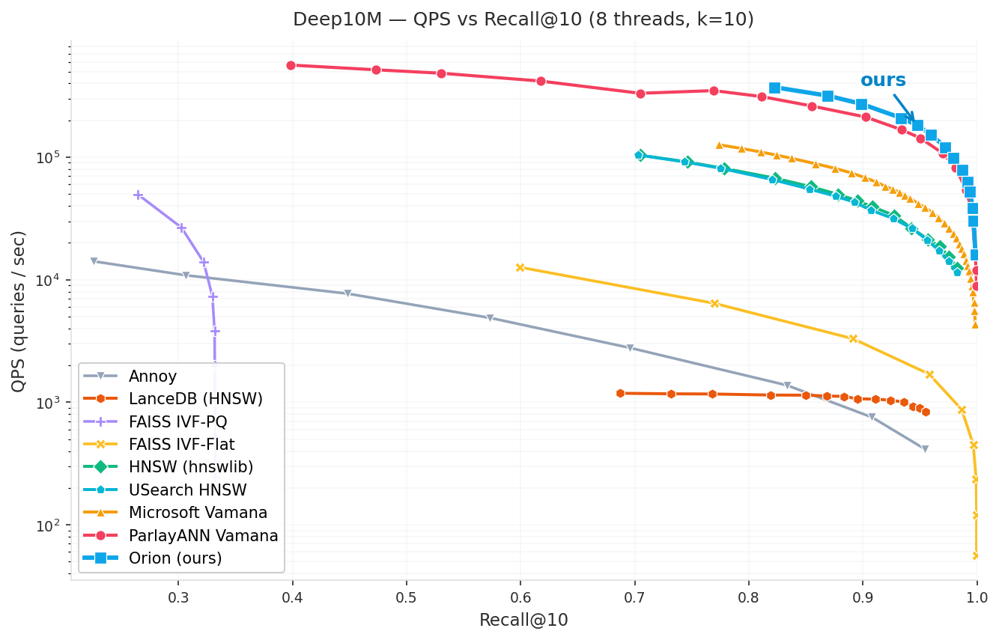
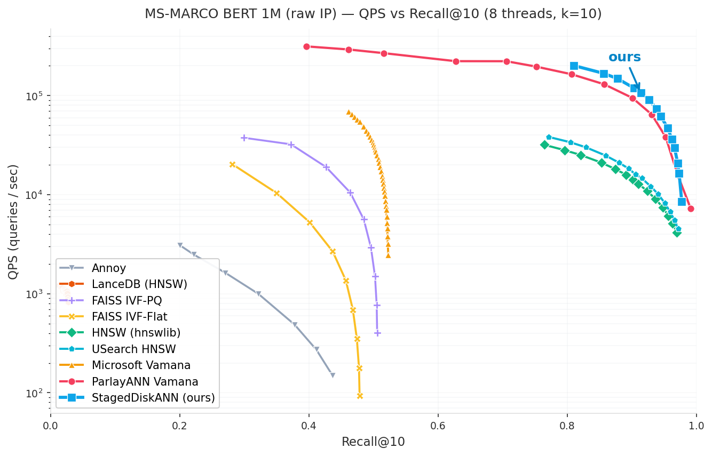

<h1> Orion Astraeus: Admission-Aware Graph Search</h1>

[](benchmark/scripts/ci_smoke_sift.sh)
[](docs/testing.md)
[-success?logo=codecov&logoColor=white)](docs/testing.md)
[](#license)
[](rust-toolchain.toml)

[](docs/platforms.md)
[](docs/platforms.md)
[](orion-py/)
[](#)

[](docs/platforms.md)
[](docs/large-datasets.md)
[](docs/graph-sources.md)
[](#rust-interface)

Orion Astraeus (Orion) is an in-memory approximate nearest neighbor engine in Rust. It combines
an admission-aware search loop, a phased graph layout, and selectable distance
precision to reduce search work. Graphs can be imported from ParlayANN or built
in-process with the bundled ParlayANN builder or the Rust DiskANN builder.

The current implementation supports f32 cascades, native-u8 L2 search,
AArch64 NEON and x86 SIMD kernels, and billion-vector in-memory runs. Linux
large allocations receive best-effort transparent huge-page advice. The
standalone CLI is separate from the benchmark harness.

## Contents

- [Quick start](#quick-start)
- [Rust interface](#rust-interface)
- [Python interface](#python-interface)
- [How search works](#how-search-works)
- [Graph selection and caches](#graph-selection-and-caches)
- [Measured performance](#measured-performance)
- [Large datasets](#large-datasets)
- [Reproducing a sweep](#reproducing-a-sweep)
- [Development and documentation](#development-and-documentation)
- [License](#license)

## Quick start

Use the pinned **Rust 1.92** toolchain and run Cargo from the repository root so
[the target configuration](.cargo/config.toml) applies. SIMD requirements and
portable x86 build flags are in [Platforms](docs/platforms.md).

```bash
rustup toolchain install 1.92
cargo build --locked --release -p orion-ann-cli --bin orion
cargo build --locked --release --target-dir target --manifest-path benchmark/Cargo.toml --bin orion-sweep
```

With your own data, a preset and ground truth are optional. Dimension is read
from the base header; specify the metric explicitly. Supported input formats
are `fvecs`, `bvecs`, `fbin`, and `u8bin`.

```bash
./target/release/orion \
  --base /data/base.fbin --query /data/query.fbin --metric l2 \
  --k 10 --search-l 100 --output results.jsonl
```

This is an `anonymous` dataset. With no cached graph or STAG export available,
the default path builds a ParlayANN graph in memory and caches it. Add `--groundtruth /data/gt.ivecs` to measure
ID recall; otherwise recall is absent. `--query - --query-format bvecs` accepts
a query stream on stdin. Use `--snapshot DIR` to search a saved index with its existing calibration. See [CLI and inputs](docs/cli.md).

Presets are in [sweep.yaml](benchmark/configs/sweep.yaml). They provide paths,
metric, dimension, construction settings, and cascade overrides:

```bash
./target/release/orion sift --print-config
./target/release/orion sift --prepare-only
./target/release/orion-sweep sift --k 10 --threads 8 --trials 3

# Plan SIFT1B before downloading data; missing inputs are labeled assumptions.
./target/release/orion sift1b --preflight --preflight-format table
```

`--prepare-only` builds/imports the graph cache without queries or calibration.
`--config path.yaml` selects an alternative configuration; bundled defaults are
embedded at compile time. Ordinary `orion` consumes queries once; `orion-sweep`
loads replayable queries and runs all requested L values/trials in one process.

## Rust interface

Use `orion_ann::Index` for owned file/array input, calibration, batch search
and cache snapshots, or `orion_ann_core::Orion::build_from_slice` for standalone
in-memory construction from f32/u8 vectors. `BuildConfig` controls the backend,
degree, construction width, extras and threads; `Orion::build` accepts an owned
padded dataset without another base copy. Saving remains explicit.
Both return the shared `orion_ann_core::Result<T>` with structured `Error` values. Errors
provide a stable code, operation, details and original source chain; creating an
error does not log it. `Error::report()` supplies the same payload exposed by
Python and the CLI's `--error-format json` option.

The prepared Cargo package names are `orion-ann-core` and `orion-ann`;
Python uses distribution `orion-ann` and import `orion_ann`. Publication is deferred until the peer-review process is complete.

Add `orion-ann` as the sole application dependency. Select built-in prefilter, admission and rerank policies through the index options.
The optional `benchmark` feature exposes research diagnostics and timing controls.

For an embedded service that owns input decoding, calibration and search workers:

```rust
use orion_ann::{BaseInput, GraphConfig, Index, IndexOptions, QueryBatch, SearchOptions};

let base: Vec<f32> = (0..256 * 128).map(|i| (i % 251) as f32).collect();
let mut index = Index::new(BaseInput::from_f32(&base, 128)?, IndexOptions {
    threads: 8,
    graph: GraphConfig { degree: 64, build_l: 128, ..Default::default() },
    cache_dir: "cache/build".into(),
    ..Default::default()
})?;
let queries = base[..32 * 128].to_vec(); // Replace with representative queries.
index.calibrate(queries.clone(), 10, Some(64))?;
let batch = QueryBatch::from_f32(&queries, index.dimension())?;
let results = index.search(batch, &SearchOptions::new(10, 100))?;
let snapshot = index.save(std::path::Path::new("cache/snapshot"))?; // New directory.
let reopened = Index::open(&snapshot,
    BaseInput::from_f32(&base, 128)?)?;
```

Use representative queries for calibration. Core L2 methods use full-precision
distances along an approximate graph. The Rust and Python `Index` APIs require
calibration for the requested `k`. Snapshots preserve calibration but **do not embed the base vectors**.
See the [core examples](orion-core/README.md) for backend selection, owned padded
storage and structured errors, and the [service example](orion-runtime/README.md)
for complete array construction, result handling and snapshot validation.

Generate the public API reference and Rust examples with:

```bash
cargo doc --locked -p orion-ann-core -p orion-ann --no-deps --open
```

## Python interface

[`orion-py`](orion-py/README.md) exposes the same graph preparation,
calibration and search runtime as the CLI. Build the extension locally with
NumPy and maturin installed:

```bash
maturin develop --manifest-path orion-py/Cargo.toml --profile python
```

```python
import numpy as np
from orion_ann import Index

index = Index.from_file("/data/base.fbin", metric="l2", threads=8)
queries = np.load("/data/queries.npy")  # C-contiguous float32, shape (nq, dim)
index.calibrate(queries[:200], k=10)
result = index.search(queries, k=10, search_list_size=100)
print(result.ids, result.counts)  # uint32 IDs (nq, k), valid counts (nq,)

snapshot = index.save("/data/orion-snapshot")  # New directory; base vectors remain separate.
reopened = Index.open(snapshot, base="/data/base.fbin", threads=8)
```

Use `Index.from_array(base, metric="l2", threads=8)` for a NumPy base, or pass a
vector-file path directly to `calibrate` and `search`. `GraphConfig` and
`CascadeConfig` select graph construction and search stages. Float32 and native
uint8 arrays are supported. The default ParlayANN backend builds directly from
native uint8 L2 data; existing graph caches and STAG exports can also be reused.
Python options use dimension/metric defaults without reading CLI presets or
legacy environment variables. See the [Python guide](orion-py/README.md) for
supported formats, cache reuse and CLI consistency tests. Wheels remain unpublished while peer review is in progress.

## How search works

1. **Graph preparation:** load/import a graph or build one in memory, then
   store local, remote, and extra candidate regions in a `PhasedGraph` slab.
2. **Calibration:** sample queries to set convergence and early-exit parameters.
3. **Search:** track admissions into the candidate queue, switch traversal
   phases as the neighborhood converges, and apply the selected
   prefilter → admission → rerank cascade.
4. **Evaluation:** optionally compare final IDs with ground truth. Graph loading,
   preparation, calibration, and recall evaluation are outside sweep search timing.

Native-u8 SIFT uses `none → native-l2-u8 → none`: original byte coordinates
serve both admission and final ranking. It avoids an f32 base and a duplicate
quantized sidecar. Generic f32 paths use the metric/dimension selector, followed
by preset and CLI overrides. See [Architecture](docs/architecture.md) and
[Configuration](docs/configuration.md).

Convergence and early exit are approximate search decisions. Their empirical
recall depends on the graph, data, calibration, and beam width.

## Graph selection and caches

The default policy is **auto**:

| Policy | Behavior on startup |
|---|---|
| `auto` | Valid PA cache → available PA staged export → in-memory PA build |
| `parlayann` | PA cache/import/build; never substitutes Rust |
| `rust` | Rust cache/build only; never imports PA |

An explicit `--staged-file` also selects PA strictly. CLI and legacy environment
settings override YAML; bundled presets use `source: auto`. **Native u8 never
falls back to Rust.** Both f32 and u8 can build directly from input rows.
The default runtime `parlay` feature bundles the builder and requires a C++17
compiler when building from source. Disabling it preserves cache/STAG loading
and the f32 Rust fallback. Explicit missing staged files remain errors.

```bash
# Pin a source for reproducible comparisons.
./target/release/orion-sweep sift --graph-source parlayann --threads 8 --trials 3
./target/release/orion-sweep sift --graph-source rust --threads 8 --trials 3
```

To generate exports, use the [STAG-capable ParlayANN fork](https://github.com/ChanchunhouZEON/ParlayANN-staged)
and [preparation scripts](benchmark/scripts/README.md). `PA_ROOT` defaults to
`../ParlayANN`. A validated cache does not require the original export to remain
on disk. Corrupt/incompatible caches and existing malformed exports fail rather
than trigger fallback.

Effective source is part of cache identity. Default directories are
`cache/orion_parlayann` and `cache/orion`; `--cache-dir` overrides the directory,
not source separation. Printed configuration, preflight and new cache manifests
record the concrete source. [Graph sources](docs/graph-sources.md) explains
precedence, provenance, SHA-256 cache identity, and builder differences.

## Measured performance

The existing **k=10, 8-thread** panel compares QPS across recall levels on
six datasets. These are the archived local Apple Silicon results; the figures
and their source measurements are unchanged.

| SIFT | GloVe-25 |
|---|---|
|  |  |
| **GloVe-100** | **GIST** |
|  |  |
| **DEEP** | **MS-MARCO** |
|  |  |

**Orion QPS / baseline QPS** at recall 0.95 and 0.99, using the same three-engine
source data as the panels. Vamana denotes the Microsoft DiskANN in-memory
implementation; ParlayANN denotes its Vamana implementation.

| Dataset | vs Vamana @ 0.95 | vs ParlayANN @ 0.95 | vs Vamana @ 0.99 | vs ParlayANN @ 0.99 |
|---|---:|---:|---:|---:|
| SIFT | 3.63× | 1.26× | 3.88× | 1.20× |
| GloVe-25 | 2.39× | 1.52× | 2.24× | 1.41× |
| GloVe-100 | 4.29× | 1.34× | 4.23× | 1.28× |
| GIST | 7.08× | 1.52× | 7.46× | 1.92× |
| DEEP | 4.28× | 1.22× | 4.64× | 1.25× |
| MS-MARCO | — | 1.29× | — | — |

Ratios use linear QPS interpolation on each measured recall frontier, without
extrapolation; `—` means the target is outside a measured range. Historical
ParlayANN results retain its original tie-aware recall. The MS-MARCO Vamana
curve does not reach 0.95 and is not assigned a speedup. Trial counts and dataset
sizes are recorded in the [source JSON files](docs/historical-benchmarks.md).
Reproduce the table with `python3 benchmark/scripts/readme_speedups.py`.

[k=100, SIFT1B and graph-source comparisons](docs/benchmarks.md) are documented
separately with their run-specific protocols.

## Large datasets

SIFT10M/100M/1B presets select native-u8 storage. For SIFT1B with dimension 128,
R=64 and extra=16, the resident base is about **119.21 GiB**, the aligned graph
slab **357.63 GiB**, and reader counters **7.45 GiB**. Their sum, **484.29 GiB**,
is a lower bound, not peak RSS. Query buffers, scratch, runtime and construction
headroom must also fit.

A graph cache occupies about **384 GB logical disk space**, separately from the
128 GB byte base and source STAG export. Filesystem allocation/quota can differ
from logical sizes. [Large datasets](docs/large-datasets.md) covers memory,
block I/O, storage planning, and import-before-search workflows.

Linux large aligned allocations use `MADV_HUGEPAGE`; actual coverage depends on
the kernel and available memory and must be measured. This does not allocate
reserved 1 GiB hugetlb pages, and the hint is inactive on macOS.

## Reproducing a sweep

Pin graph source, hardware/thread placement, data order, k, L schedule, compiler
flags, and timing protocol. The recent local results used the following
prefetch overrides; these are **experimental settings, not compiled defaults**:

```bash
export ORION_DSTREAM_LA_Q=32
export ORION_DSTREAM_LA_TRUTH=32
export ORION_DSTREAM_SINK_BURST=32
export ORION_DSTREAM_BURST_TRIGGER_LINES=8
export ORION_DSTREAM_BURST_AHEAD_VECTORS=4
# Benchmark-only override (the compiled default is also 2).
export ORION_RERANK_FACTOR=2

./target/release/orion-sweep gist --graph-source parlayann \
  --k 100 --threads 8 --trials 3 --print-config
./target/release/orion-sweep gist --graph-source parlayann \
  --k 100 --threads 8 --trials 3
```

Record the actual source and cache identity before comparing runs. Equal R,
construction L and alpha do not imply equal graph topology. Cache eviction is
best effort, and native engine timing/cache policies are not automatically
identical. Avoid interpreting changes between unpaired historical runs as a
causal speedup.

## Development and documentation

```bash
cargo test --locked -p orion-ann -p orion-ann-cli
cargo check --locked --manifest-path benchmark/Cargo.toml --bins
cargo test --locked -p orion-ann-vector --release
```

[Test coverage and CI](docs/testing.md) describes regression checks, coverage
measurement, and hardware execution in CI.

| Guide                                               | Contents                                        |
| --------------------------------------------------- | ----------------------------------------------- |
| [CLI and inputs](docs/cli.md)                       | Anonymous data, streams, optional GT, preflight |
| [Configuration](docs/configuration.md)              | Presets, precedence, cascade, tuning units      |
| [Graph sources](docs/graph-sources.md)              | Auto selection, strict modes, cache provenance  |
| [Large datasets](docs/large-datasets.md)            | Native u8, block I/O, SIFT1B memory/storage     |
| [Benchmarks](docs/benchmarks.md)                    | Dated results and comparison methods            |
| [Historical figures](docs/historical-benchmarks.md) | Existing figures and data, unchanged            |
| [Architecture](docs/architecture.md)                | Graph layout and admission-aware search         |
| [Optimizations](docs/optimizations.md)              | Kernel/search implementation notes              |
| [Ablation study](docs/ablation-study.md)            | Cascade and adaptive-search diagnostics         |
| [Platforms](docs/platforms.md)                      | SIMD builds, Linux THP, portability             |
| [Testing](docs/testing.md)                          | Regression checks and CI scope                  |
| [Code structure](docs/code-structure.md)            | Workspace crate responsibilities                |

## License

[MIT](LICENSE). Copyright Chanchunhou; inherited Microsoft DiskANN files retain
their original Microsoft copyright notices.
